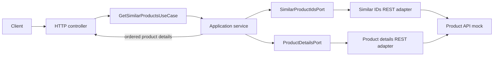

# Similar Products API

A Java 21 and Spring Boot service that aggregates product details for a requested product's similar items. This repository is a backend technical assessment for Nunegal Consulting and includes the API contracts, mock services, and a k6 load-test scenario.

## At a glance

| Component | Value |
| --- | --- |
| Runtime | Java 21, Spring Boot 4.1.2, Spring MVC, Spring `RestClient` |
| Build | Maven Wrapper 3.3.4, Apache Maven 3.10.0 |
| Public endpoint | `GET /product/{productId}/similar` |
| Application port | `5000` by default |
| Product API mock | `http://localhost:3001` by default |
| Product detail concurrency | 100 active lookups and 1000 queued lookups per instance by default |
| Test tools | JUnit 5, Mockito, AssertJ, MockMvc, MockWebServer 5.3.0 |
| Load-test stack | Docker Compose, k6 0.28.0, InfluxDB 1.8.2, Grafana 8.1.2 |

## Quick start

### Prerequisites

- Java 21. A global Maven installation is not required; the Maven Wrapper downloads the pinned Apache Maven version on first use.
- Docker Desktop with Docker Compose v2, for the supplied mock APIs and load-test infrastructure.

### Build and verify

On macOS or Linux:

```bash
./mvnw --batch-mode verify
```

On Windows PowerShell:

```powershell
.\mvnw.cmd --batch-mode verify
```

### Start the dependencies and application

Start the mock APIs and load-test reporting services:

```bash
docker compose up -d simulado influxdb grafana
```

In a separate terminal, run the application:

```bash
./mvnw spring-boot:run
```

On Windows PowerShell:

```powershell
.\mvnw.cmd spring-boot:run
```

The application listens on port `5000`. Check the endpoint:

```bash
curl --fail --silent http://localhost:5000/product/1/similar
```

In Windows PowerShell:

```powershell
Invoke-RestMethod http://localhost:5000/product/1/similar | ConvertTo-Json -Depth 4
```

The mock returns similar IDs `[2, 3, 4]` for product `1`. The API returns their details in that order.

To stop the application, press `Ctrl+C` in its terminal. Stop the Docker services when finished:

```bash
docker compose down
```

## API

### `GET /product/{productId}/similar`

Returns a JSON array. Each product contains `id`, `name`, `price`, and `availability`:

```json
[
  {
    "id": "2",
    "name": "Dress",
    "price": 19.99,
    "availability": true
  }
]
```

Product details with `availability: false` are included. An empty list of similar IDs returns `[]`.

The public response schema is defined in [similarProducts.yaml](./similarProducts.yaml). The upstream mock contracts are in [existingApis.yaml](./existingApis.yaml):

| Purpose | Method and path | Default base URL |
| --- | --- | --- |
| Retrieve ordered similar product IDs | `GET /product/{productId}/similarids` | `http://localhost:3001` |
| Retrieve one product detail | `GET /product/{productId}` | `http://localhost:3001` |

Similar product IDs are processed once each, preserving the first occurrence order returned by the upstream service. Invalid similar-ID responses containing a null or blank ID are treated as an upstream failure. Product detail responses must contain non-blank `id` and `name` values, and the returned ID must match the requested ID; malformed details are treated as technical lookup failures.

### Failure behavior

| Situation | Public API behavior |
| --- | --- |
| The similar-ID service returns `404` for the requested product | Return `404 Not Found` |
| The similar-ID service has another HTTP, transport, or timeout failure | Return `502 Bad Gateway` |
| The similar-ID service returns a null or blank ID | Return `502 Bad Gateway` |
| A related product detail returns `404` | Omit that product; return `200 OK` with `[]` if all related products are missing |
| A related product detail has a blank `id` or `name`, or an ID different from the requested ID | Treat as a technical detail lookup failure |
| Some detail lookups fail technically and at least one succeeds | Return `200 OK` with successful details in their original relative order |
| No detail succeeds and at least one detail lookup fails technically | Return `502 Bad Gateway` |
| Lookup capacity is exhausted and no detail succeeds | Return `503 Service Unavailable` |
| Lookup capacity is exhausted but some details succeeded | Return `200 OK` with the successful details |

## Configuration

Set these environment variables to override the defaults:

| Setting | Environment variable | Default |
| --- | --- | --- |
| Application port | `SERVER_PORT` | `5000` |
| Product API base URL | `PRODUCT_API_BASE_URL` | `http://localhost:3001` |
| Product API connection timeout | `PRODUCT_API_CONNECT_TIMEOUT` | `500ms` |
| Product API read timeout | `PRODUCT_API_READ_TIMEOUT` | `2s` |
| Maximum active product detail lookups per instance | `PRODUCT_API_MAX_CONCURRENT_LOOKUPS` | `100` |
| Pending product detail lookup queue capacity per instance | `PRODUCT_API_LOOKUP_QUEUE_CAPACITY` | `1000` |

The lookup executor is shared by requests handled by one application instance. Non-positive concurrency or queue settings prevent the application from starting.

## Architecture

The application uses a small hexagonal structure. The use case coordinates the upstream calls through ports and remains independent of HTTP transport and Spring configuration.



Product detail calls run concurrently on a bounded executor. Results are collected in the order provided by the similar-ID service, even when the upstream calls finish in a different order. Spring beans and executor settings are wired in the configuration package.

## Tests and CI

Run the complete Maven verification locally:

```bash
./mvnw --batch-mode verify
```

Use `.\mvnw.cmd --batch-mode verify` in Windows PowerShell. The test suite covers the HTTP contract, adapter paths and error mapping, timeouts, ordering, partial failures, concurrency, and executor saturation. HTTP adapters are tested with MockWebServer; unit tests do not require Docker.

GitHub Actions runs the same Maven verification command on every push and pull request. See [the CI workflow](./.github/workflows/ci.yml).

## Load test

The supplied k6 scenario exercises normal, not-found, error, slow, and very-slow product cases. It starts up to 200 virtual users for 10 seconds per scenario and sends requests to `host.docker.internal:5000`.

With the mock and reporting services running and the application started, run:

```bash
docker compose run --rm k6 run scripts/test.js
```

On Windows PowerShell, use the same Docker Compose command. Open the [Grafana k6 dashboard](http://localhost:3000/d/Le2Ku9NMk/k6-performance-test) to inspect the recorded metrics.

The script records load and response metrics but does not validate response bodies or define pass/fail thresholds. A successful k6 process exit confirms that the scenario completed; review the results against any acceptance targets supplied by the evaluator. Functional response assertions belong in the Maven tests.

One local run on 25 October 2026 completed 11,898 HTTP requests at 170.6 requests per second, with 490 ms average latency, 5.47 s p95 latency, and 11.08 s maximum latency. These aggregate figures include the slow and very-slow scenarios and are a local observation, not an acceptance target. The first three scenarios use `gracefulStop: 0s`, so their in-flight iterations can be interrupted when each scenario ends.

## Project structure

```text
src/main/java/com/maxips/backenddevtest/similarproducts/
|-- adapter/
|   |-- in/web/       # HTTP endpoint, response DTO, and error mapping
|   `-- out/http/     # REST clients and upstream response mapping
|-- application/     # Use-case orchestration and application exceptions
|-- config/          # Executor and application bean wiring
|-- domain/          # Product detail model
`-- port/
    |-- in/          # Use-case contract
    `-- out/          # Upstream product API contracts

src/test/java/        # Unit, web, configuration, and HTTP adapter tests
shared/simulado/      # Mock API response definitions
shared/k6/            # k6 scenario
shared/grafana/       # Grafana provisioning and dashboard
```

## Technical references

- [Public API contract](./similarProducts.yaml)
- [Upstream API contracts](./existingApis.yaml)
- [Docker Compose services](./docker-compose.yaml)
- [GitHub Actions CI](./.github/workflows/ci.yml)
